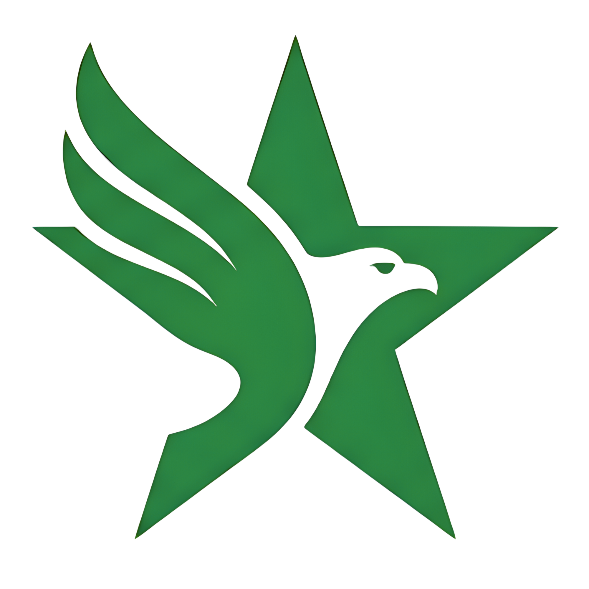
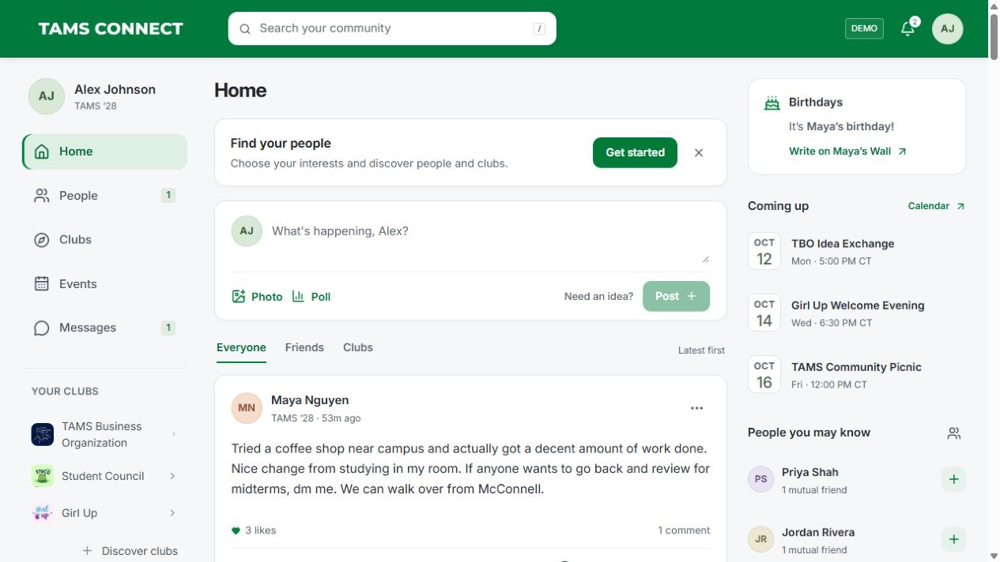

<p align="center">
  
</p>

<h1 align="center">TAMS Connect</h1>

<p align="center">
  I made TAMS Connect so TAMS students and alumni could find each other, share what they're up to, and make plans in one place.
</p>

<p align="center">
  <a href="https://tamsconnect.github.io/">Try TAMS Connect</a>
</p>

<p align="center">
  
</p>

## Features

- Student profiles and friend requests
- Posts, photos, comments, @mentions, and polls
- Club pages with their own walls
- An event calendar with RSVP, reminders, and photo collections
- Messages and notifications
- Saved posts and events, drafts, editing, and undo

## Build

I used React, TypeScript, and Tailwind CSS for the interface, with Vite to build the site for GitHub Pages. The demo saves activity in the browser, so it runs without a server or API keys.

To run it locally, use Node.js 22.18 or newer:

```sh
npm ci
npm run dev
```

Run `npm run build` to prepare the website files for publishing.

## About this project

I'm Subhas Angara, a Class of 2029 TAMS applicant. I made this project to explore an idea for student life at TAMS and show my interest in CS through something people could actually try.

I made this independently; it isn't an official UNT TAMS app. I used club names and logos from public Instagram profiles. All accounts, conversations, and events are fictional, and each visitor's activity stays in their own browser.
